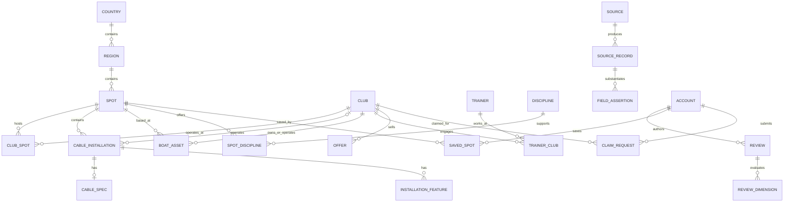

# SpotMap — Data Model v1.0

**Статус:** проектный канон для реализации (P0 / P1 / P2 различены).  
**Версия:** 1.0 · **Дата:** 11.11.2026 · **База:** PostgreSQL 16+ / PostGIS 3+.  
**Зависимые файлы:** `SpotMap_Postgres_Schema_v1.sql`, `SpotMap_Spot_Passport_Wakesurf_v1.md`, `SpotMap_Cable_Installation_Passport_v1.md`, `SpotMap_SpotScore_Formula_v1.md`.

## 0. Решения, которые обязательны для реализации

1. **P0-дисциплины: Wakesurf и Wakeboard — электротяга (cable wakeboarding)**. Катерный wakeboard поддерживается в модели с P0-поиском, детализация его паспорта — P1; water ski — следующая отдельная вертикаль. Порядок исследовательской работы по рынку может начинаться с wakesurf, **но электротяга не откладывается на следующий релиз**.
2. **Все установленные/выявленные объекты электротяги должны учитываться в реестре** — полноразмерные кольцевые, реверсивные двухопорные, бассейновые/крытые и другие идентифицированные типы. На карте отдельный маркер каждой геоподтверждённой установки; никаких выдуманных координат.
3. **Spot ≠ Club ≠ Installation ≠ Boat ≠ Trainer ≠ Session**. Не смешивать клуб/бренд, площадку, отдельную лебёдку и тренировку.
4. **Не считать все записи реестра подтверждёнными работающими клубами**. Импорт из MyWave Wake Intelligence V2 идёт через staging и provenance.
5. **Качество, достоверность и актуальность — три разных измерения**: `SpotScore`, `Data Confidence`, `Freshness`. Не продавать место в рейтинге.
6. **Не публиковать точку без геоподтверждения**. При отсутствии координат объект доступен в поисковом списке как «требует проверки местоположения», но не изображается ложным пином.

## 1. Задачи модели

- Одно физическое место может содержать несколько клубов и несколько электротяговых установок.
- Один клуб может работать на нескольких спотах и с несколькими тренерами/катерами.
- Одна установка имеет собственные статус, тип, геометрию, трассу, фигуры, часы работы и доказательства.
- Каждый существенный факт может иметь несколько противоречащих источников и историю изменения; разрешённое значение и источник остаются доступны.
- Погода привязана к координатам/водоёму, а не к бренду клуба. Прайс и сервис принадлежат оператору. Рейтинг может быть у клуба, спота или установки, но не смешивается.
- Приложение поддерживает неизменяемую историю источников, модерацию, Claim и безопасное удаление/слияние дублей.

## 2. Концептуальная ER-диаграмма



**Кардинальности:** `spots ↔ clubs` — M:N через `club_spots`; `spots → installations` — 1:N; `club → installations` — 1:N опционально (оператор может быть неизвестен); `installation → cable_spec` — 1:1; `installation → features` — 1:N; `club ↔ trainers` — M:N; `club → boats/offers` — 1:N. `Session` P1 ссылается на spot, club, дисциплину и **ровно один тип средства тяги** (`boat` либо `cable_installation`), когда он известен.

## 3. Таксономия дисциплин — канон

| slug | Название UI | propulsion | Стартовый статус | Примечание |
|---|---|---|---|---|
| `wakesurf` | Вейксёрфинг | `boat` | **P0** | волна катера |
| `wakeskim` | Вейкским | `boat` | P0 в паспорте / P1 отдельные UX-фильтры | не терять в общей категории |
| `wakeboard_cable` | **Вейкборд — электротяга** | `cable` | **P0** | установки на карте обязательно |
| `wakeboard_boat` | Вейкборд — катер | `boat` | P0 каталог / P1 паспорт | другой тип инфраструктуры |
| `wakeskate_cable` | Вейкскейт — электротяга | `cable` | P1 | отдельный тег |
| `waterski_boat` | Водные лыжи — катер | `boat` | P1 | дальнейшее расширение |
| `waterski_cable` | Водные лыжи — электротяга | `cable` | P1 | **не смешивать** с `wakeboard_cable` |

**Правило:** это не синонимы. В UI допустим родительский фильтр «Вейкборд» со значениями «Катер» и «Электротяга», но API должен возвращать однозначные `slug`. Термины «канатка», «реверс», «лебёдка», «кольцевая», «электротяга», «cable wake» используются как поисковые алиасы, **не как тип дисциплины**.

## 4. Обязательные таблицы и границы владения фактами

Легенда: **P0** — MVP; **P1** — ближайшая следующая версия; **P2** — расширение.

| Таблица | PK | FK / связи | Назначение | Приоритет |
|---|---|---|---|---|
| `countries` | `code` | — | ISO 3166-1 alpha-2 | P0 |
| `regions` | `id` | country | административная иерархия | P0 |
| `spots` | UUID | region | географический объект/водоём/площадка; **не клуб** | P0 |
| `clubs` | UUID | — | бренд/юрлицо/оператор | P0 |
| `club_spots` | `(club_id,spot_id)` | оба | множество площадок у клуба | P0 |
| `disciplines` | `slug` | — | единая таксономия | P0 |
| `spot_disciplines` | `(spot,discipline)` | оба | общая пригодность места | P0 |
| `club_disciplines` | `(club,discipline)` | оба | реально предлагаемые услуги | P0 |
| `cable_installations` | UUID | spot, club? | **отдельная установка электротяги** | **P0** |
| `installation_disciplines` | `(installation,discipline)` | оба | виды спорта на установке | P0 |
| `cable_specs` | installation UUID | installation | тип/длина/опоры/скорости/трасса | **P0** |
| `installation_features` | UUID | installation | кикеры, боксы, рейлы, др. фигуры | **P0** |
| `boats` | UUID | club, home spot? | парк катеров | P0 |
| `trainers` | UUID | — | профиль тренера | P0 |
| `trainer_clubs` | `(trainer,club)` | оба | связь тренера с клубами | P0 |
| `offers` | UUID | club, spot?, discipline, boat? / installation? | текущие/исторические услуги и цены с учётом площадки | P0 |
| `opening_hours` | UUID | target entity | часы/сезоны по локальному времени объекта | P0 |
| `entity_aliases` | UUID | target entity, source record | поиск по названиям и локальным синонимам | P0 |
| `amenity_catalog` | slug | — | стандартизированные удобства | P0 |
| `spot_amenities` | `(spot,amenity)` | оба | удобства физических мест | P0 |
| `club_amenities` | `(club,amenity)` | оба | сервис конкретного клуба | P0 |
| `media_assets` | UUID | owner entity reference | фото/видео с авторством и правами | P0 |
| `sources` | UUID | — | каталог первоисточников с типом/правами | P0 |
| `source_records` | UUID | source | одна извлечённая запись / OSINT-снимок | P0 |
| `field_assertions` | UUID | source_record | доказательство конкретного поля | **P0** |
| `import_batches` | UUID | — | воспроизводимый ETL и dry-run | P0 |
| `staged_places` | UUID | import_batch | кандидаты до геоподтверждения | **P0** |
| `dedup_candidates` | UUID | staged_place | гипотезы совпадения, не авто-merge | P0 |
| `accounts` | UUID | — | пользователи и внутренние роли | P0 |
| `claim_requests` | UUID | account, club | верификация прав владельца | P0 |
| `change_proposals` | UUID | account? | UGC-исправления/модерация | P0 |
| `reviews` | UUID | account, target | структурированный отзыв | P0 |
| `review_dimensions` | `(review,dimension)` | review | 1–5 по категориям | P0 |
| `score_assessments` | UUID | evidence? | нормализованное наблюдение 0–100 | P0 |
| `score_snapshots` | UUID | target | детерминированный результат расчёта версии | P0 |
| `saved_spots` | `(account,spot)` | оба | избранное | P0 |
| `audit_events` | UUID | actor? | неизменяемый журнал изменений | P0 |
| `operating_periods` | UUID | spot/club/installation | сезонные интервалы работы | P1 (статус P0) |
| `sessions` | UUID | account, spot, club?, trainer? | тренировочные сессии | P1 |
| `visits` | UUID | account, spot | Proof of Ride | P1 |
| `collections` / `collection_items` | UUID | account | коллекции | P1 |
| `forecasts` / `condition_observations` | UUID | spot/installation | прогноз / фактические условия | P1/P2 |

**Где нет SQL-FK по `entity_type + entity_id`:** универсальные source/assertion и media используют проверяемые приложением типизированные ссылки и очередь целостности; основные объектные связи строятся на реальных FK. На этапе production желательно ввести специализированные join-таблицы доказательств по target или trigger для контроля полиморфных ссылок.

## 5. Основные поля сущностей и их инварианты

### 5.1. `spots`

- `id UUID`; `display_name`, `slug`, `kind` (`waterbody|wakepark|pool|other`);
- `country_code`, `region_id`, `locality`, `address_text`;
- `point geography(Point,4326) NULL`; координаты хранятся WGS84 и в API выдаются **[longitude, latitude]**;
- `geo_status` (`missing|approximate|verified|disputed`); `geo_verified_at`;
- `publication_status` (`draft|pending|published|hidden|merged`);
- `operation_status` (`open|seasonal_closed|temporarily_closed|permanently_closed|planned|unknown`);
- `waterbody_type`, `season_note`, `description`, `created_at`, `updated_at`, `merged_into_id`.

**Инвариант:** `geo_status='verified'` требует `point IS NOT NULL` и `geo_verified_at IS NOT NULL`. В `map_points` участвуют только опубликованные объекты с подтверждёнными координатами. Геокодированная приблизительная точка без подтверждения — не «verified».

### 5.2. `clubs`

- идентификаторы/алиасы бренда, сайт, контактные каналы, описание, тип услуг;
- `publication_status`, `claim_status`, `operation_status`;
- связь с одним или многими `spots`; у бренда **нет единой физической координаты**, если площадок несколько.

### 5.3. `cable_installations` — P0

- `spot_id` (обязателен), `operator_club_id` (необязателен);
- `name`, `installation_code` (локально уникальное на споте), `installation_type` (`full_size_circuit|two_tower_reversible|multi_tower_other|pool_cable|portable_other|unknown`);
- `point geography(Point,4326)` **отдельно от центра спота**; geo status/time;
- `operation_status`, `publication_status`, `public_access_status` (`public|members_only|private|unknown`);
- `commissioned_year`, `manufacturer`, `model`, `season_notes`;
- `last_operation_confirmed_at`, `created_at`, `updated_at`.

Если на одной площадке 3 реверсивные установки, в базе **3 записи `cable_installations`**, если подтверждено, что это 3 отдельные установки, а не 3 буксировочных фала одной системы. Каждая имеет свою карту, фигуры, профиль и статус.

### 5.4. `cable_specs`

- `installation_id PK/FK`;
- `tower_count` (`NULL`, когда неизвестно);
- `track_length_m`, `cable_height_m`, `max_riders`, `carrier_count`;
- `direction` (`clockwise|counterclockwise|bidirectional|reversible|unknown`);
- `speed_min_kmh`, `speed_max_kmh`;
- `start_type` (`dock|ramp|pool|other|unknown`);
- `water_depth_min_m` (при наличии разрешённого источника);
- `track_geojson`/`route_geometry` — линия/контур трассы после подтверждения;
- `requires_helmet`, `lifejacket_policy`, `beginner_mode`, `night_riding`, `winter_indoor` как nullable-трёхзначные факты, а не ложные `false`.

**Важно:** `tower_count=2` не доказывает автоматически реверсивный режим; тип установки указывается по источнику.

### 5.5. `installation_features`

- тип (`kicker|box|rail|slider|pipe|funbox|other`), название;
- сложность (`beginner|intermediate|advanced|pro|unknown`);
- расположение относительно трассы, доступное направление;
- status (`active|removed|damaged|unknown`); evidence / updated_at.

### 5.6. `boats`

- клуб-владелец/оператор; spot базирования необязателен;
- manufacturer, model, year, engine, surf_system, ballast, regular/goofy, capacity, board availability;
- `availability_status`, `verified_at`; технические параметры, которые нельзя подтвердить, остаются `NULL`.

### 5.7. `offers`

- принадлежит клубу, содержит `discipline_slug`;
- контекст услуги (`training|ride_set|rental|intro|camp|other`), длительность и единицы;
- `amount_minor` / `currency_code` (`RUB` и т. д.); `spot_id` при разных прайсах филиалов; валидность `valid_from`,`valid_to`;
- `price_status` (`current_verified|current_unverified|historical|expired|quote_only`);
- `boat_id` **или** `installation_id` (не обе сразу), либо услуга без привязки к конкретному оборудованию;
- все цены 2024 не должны выводиться как текущие в 2026.

### 5.8. `reviews`

- автор, дата посещения и дата публикации (раздельно);
- target (spot/club/installation), уровень райдера, дисциплина;
- опциональное подтверждение (`unverified|geo|qr|booking|trainer|admin`);
- статус модерации и риск накрутки; конфликты интересов;
- `review_dimensions`: условия, тренеры, оборудование, безопасность, сервис, инфраструктура, value; сами оценки — не юридическая сертификация безопасности.

## 6. Источники и Provenance — объект первого класса

**`source`** — сайт, Telegram, официальная публикация, владелец, пользователь, реестр соревнования.  
**`source_record`** — конкретная страница, сообщение или снимок на дату выгрузки.  
**`field_assertion`** — утверждение источника: `club:uuid / offers.price / 690000 RUB коп. / observed 2024`.

Обязательные поля утверждения:
- `target_type`, `target_id`, `field_path` (JSON Pointer или канонический path);
- `value_json`, `source_record_id`, `asserted_at`, `observed_at`, `valid_from`, `valid_to`;
- `verification_status` (`proposed|accepted|rejected|superseded|disputed`);
- `confidence_level` (`low|medium|high`), `reviewed_by`, `reviewed_at`.

**Не выводить «проверено 3 дня назад» по `created_at` записи или моменту парсинга.** Это именно дата подтверждения факта, а не дата копирования страницы.

## 7. Цикл жизни данных

```text
FOUND → STAGED → ENTITY_MATCHED → GEO_PENDING
                  ↓                 ↓
              DUPLICATE?         GEO_VERIFIED
                  ↓                 ↓
            MANUAL_REVIEW      FIELD_VERIFIED
                  └──────┬──────────┘
                         ↓
                   PUBLISHED
                         ↓
                  RECHECK_DUE
                         ↓
               UPDATED / HIDDEN
```

### Публикация электротяги

- `candidate+no_coordinates`: реестр кандидатов, доступен в списке «Не подтверждено»; **не пин**.
- `coordinates_verified+operation_unknown`: пин с серой маркировкой «статус работы неизвестен».
- `coordinates_verified+seasonal_closed`: пин с сезонным статусом; фильтр «все» не скрывает.
- `coordinates_verified+operational`: пин с признаком «работает» **только при свежем доказательстве**.
- `permanently_closed`: сохраняется в базе/истории, по умолчанию скрыт из активного поиска; доступен в режиме «архив».
- `duplicate`: не удаляется физически до сверки и фиксации `merged_into_id`/аудита.

## 8. Модель карты — полное покрытие электротяги

В API карта возвращает **два независимых типа точек**:

1. `spot` — физическая площадка, водоём, центр активности.
2. `cable_installation` — конкретная электроустановка с точным `installation_id`.

При крупном масштабе рендерится сгруппированный marker площадки: `«5 установок»`. При приближении — отдельные пины каждой установки, включая несколько на одной территории. Нельзя сворачивать 3 лебёдки в одну сущность лишь из-за общего Telegram или адреса.

**Управление слоями:** `Вейксёрф`, `Вейкборд — электротяга`, `Вейкборд — катер`, `Водные лыжи`; для Cable: `Кольцевая`, `Реверсивная`, `Крытая`, `Все`, `Статус`.

**При запросе всех установок** `GET /v1/map/points?discipline=wakeboard_cable&entity=installation&status=all` показывает все геоподтверждённые установки независимо от их сезонного статуса, кроме скрытых/объединённых сущностей и негеолокализованных кандидатов. Для последних отдельный `GET /v1/places/candidates?needs_geo=true` с доступом по роли и публичной пометкой, где уместно.

### Map payload

```json
{
  "type": "Feature",
  "geometry": {"type": "Point", "coordinates": [37.4, 55.7]},
  "properties": {
    "entity_type": "cable_installation",
    "entity_id": "<uuid>",
    "spot_id": "<uuid>",
    "discipline": "wakeboard_cable",
    "installation_type": "two_tower_reversible",
    "operating_status": "unknown",
    "geo_status": "verified",
    "verified_at": "<ISO timestamp>",
    "warning": "operation_not_verified"
  }
}
```

**Координаты в примере выше — технический пример формата, не фактическая локация!** В production и seed-файлах с реальными брендами использовать только подтверждённые значения.

## 9. Алгоритм дедупликации

Генерация кандидатов (не автоматическое слияние):
- нормализованные имена/алиасы;
- совпадающий сайт и домен;
- официальный контакт;
- близость геометрии (после проверки);
- общая организация или Telegram;
- дисциплины и адрес;
- доказательство филиалов/нескольких площадок.

Различать связи `same_entity`, `same_brand`, `same_site`, `same_operator`, `possible_alias`, `unrelated`. Одинаковый Telegram-канал **не** доказывает одну площадку, а близкий адрес **не** доказывает одну лебёдку. Решение о merge записывает review, source IDs и reversible redirect.

## 10. Импорт MyWave Wake Intelligence V2 (прикреплённый архив)

**Срез файла:** 08.11.2026; 80 записей-кандидатов на листах `06_ПАСПОРТА_80`, `07_КАЧЕСТВО_80`, `09_GEO_SPOTMAP`; отдельные алиасы на `08_АЛИАСЫ`. По README географические координаты и работа в сезоне 2026 **не подтверждены**, поэтому они не являются картографическим реестром готовых публичных пинов.

### Порядок ETL

1. Загружать в `import_batches`: источник, SHA-256, версия, дата.
2. Для каждой строки `06_ПАСПОРТА_80` создать `staged_places` с исходным `legacy_row_id`, текстом адреса и исходным URL.
3. Нормализовать дисциплины, **не** превращать неизвестный «вейкборд» автоматически в `wakeboard_cable`.
4. Из текстов «кабельный», «реверсивные», «лебёдка», «кольцевая» создать гипотезу `installation_candidate`, а не подтверждённую электроустановку.
5. `09_GEO_SPOTMAP` импортировать как геозадачи, не как реальные point geometry.
6. `08_АЛИАСЫ` импортировать как `dedup_candidates`, не применять auto-merge.
7. Явно отделить Telegram channel/user engagement от статистики посещений и доходов.
8. При подтверждении координат/типа/эксплуатации выпускать новый `field_assertion` и создавать канонические `spot` и `cable_installation`.
9. После реальной геопроверки — публиковать пины и проходить map coverage QA.

### Конкретные кабельные кандидаты в пакете (не исчерпывающая карта России)

| Запись в книге | Заявленные признаки | Требуемая проверка |
|---|---|---|
| WakeHome | лебёдка | отдельная установка? тип и координаты |
| WakeStyle Spot (Крылатское) | **3 реверсивные лебёдки** | три уникальные установки, точки, сезонность |
| WAKESTYLE — бассейн «Энигма» | крытый бассейн, лебёдка Spin | отдельная площадка, координаты внутри объекта, сезонность |
| Flat Wake Park | лебёдка | тип, количество, эксплуатация |
| Reef Surf Club | лебёдка | актуальность и количество |
| Wakesummer Park | кольцевая лебёдка | полная конфигурация, статус |

Указанные объекты — **кандидаты из загруженного пользовательского набора**, а не независимо подтверждённый полный список действующих установок на 11.11.2026. Каталог электротяги России требуется дополнительно собирать из независимых локальных источников и проверять каждую установку.

## 11. API-контракты (v1)

| Метод / endpoint | Действие | Особенности |
|---|---|---|
| `GET /v1/map/points` | кластеризуемые точки | bbox, zoom, sport, installation_type, status, verified_only |
| `GET /v1/spots/{id}` | spot + отношения | точка, работающие клубы, установки |
| `GET /v1/clubs/{id}` | club + offers/boats | паспорт, контакты, источники |
| `GET /v1/installations/{id}` | Cable Passport | отдельная установка с полями и доказательствами |
| `GET /v1/search` | поиск по тексту | sport, city, name, aliases, sorting |
| `GET /v1/spots/{id}/score` | SpotScore и explain | не смешивать с Confidence |
| `POST /v1/places/proposals` | добавить кандидат | rate-limit, moderation, abuse protection |
| `POST /v1/clubs/{id}/claims` | Claim Spot | привилегии только после проверки |
| `POST /v1/reviews` | отзыв | moderation, anti-fraud |
| `GET /v1/admin/staging` | очередь OSINT | роль Data Moderator |
| `POST /v1/admin/geo-verify` | подтверждение гео | audit, proof, operator |

### Пример запроса PostGIS (метры)

```sql
SELECT i.id, i.name, ST_Distance(i.point,
       ST_SetSRID(ST_MakePoint(:lon, :lat),4326)::geography) AS distance_m
FROM cable_installations i
JOIN installation_disciplines d ON d.installation_id = i.id
WHERE d.discipline_slug = 'wakeboard_cable'
  AND i.publication_status = 'published'
  AND i.geo_status = 'verified'
  AND ST_DWithin(i.point,
      ST_SetSRID(ST_MakePoint(:lon, :lat),4326)::geography, :radius_m)
ORDER BY distance_m LIMIT 100;
```

На `point` нужен `GiST` spatial index. Долгота перед широтой в `ST_MakePoint`.

## 12. Индексы и производительность

- GIST по `spots.point` и `cable_installations.point`;
- B-tree по publication/operation/status; sport-bridge table;
- `pg_trgm` для русских имён, алиасов и похожих названий;
- уникальные `(spot_id, installation_code)` при наличии кода;
- отдельный materialized / cached map layer (P1) только после измерения нагрузки;
- `bbox` + `zoom` + TTL + cursor-pagination для списков;
- для UI кластеры могут вычисляться сервером на плотных масштабах или клиентом на небольшом датасете; server-side clustering — P1.

## 13. Безопасность, приватность, лицензии

- PII тренеров/пользователей — только с надлежащим основанием и доступом по роли;
- raw Telegram User IDs из пользовательского XLSX не вносить в публичную БД SpotMap; аналитика каналов — агрегированно, без отождествления подписчиков с клиентами;
- роль `Rider` не должна видеть `import_batches`, private claim evidence, IP/device anti-fraud signals;
- файлы/медиа с правами публикации; нельзя массово копировать медиа без разрешения;
- OSM data и tiles различаются: атрибуция ODbL, правила tiles и геокодера проверяются отдельно;
- история изменений (audit log) должна сохранять **кто/что/когда/почему**; личные данные в логе минимизировать;
- экспорт и удаление данных по законным запросам пользователя — отдельный workflow.

## 14. Acceptance Criteria — Data Model DoD

- [ ] Может существовать один Spot с двумя Club без дублирования географии.
- [ ] Один Spot с тремя реверсивными установками создаёт 3 installation IDs и 3 видимых пина при достаточном масштабе.
- [ ] Установка может принадлежать клубу или иметь неизвестного оператора.
- [ ] Установки без подтверждённых координат НЕ отображаются ложными пинами; остаются задачами в GEO-очереди.
- [ ] `wakeboard_cable` отличается от `wakeboard_boat`, `waterski_cable` и `wakesurf` во всех API, фильтрах и аналитике.
- [ ] Условия воды принадлежат Spot, оборудование — Club/Installation; тариф — Offer; визит — Session.
- [ ] Один канал Telegram может быть связан с несколькими площадками без удвоения аудитории.
- [ ] Исторические цены не появляются в текущих офферах.
- [ ] Слияния дублей обратимы и аудируемы.
- [ ] Любое поле из OSINT можно проследить до исходной строки/URL и времени проверки.
- [ ] Качество, достоверность, свежесть доступны независимо.
- [ ] Ролевой доступ защищает непубличные данные.
- [ ] API не возвращает неподтверждённое «сейчас открыто».
- [ ] SQL-миграция, контракт JSON Schema и тесты оценки проходят CI.

## 15. Основные риски и меры

| Риск | Проявление | Контроль |
|---|---|---|
| «Полнота» реестра преувеличена | пропущены маленькие реверсы | раздельные метрики `discovered`, `geo_verified`, `operational_verified`, ежемесячный локальный OSINT |
| Ошибка слияния | 3 установки превращены в 1 | Installation — самостоятельный ID, ручная проверка |
| Фиктивные координаты | ложный пин на карте | NULL + geo-state gate |
| Старый прайс | 2024 показан как действующий | validity / historical status |
| Отзывы накручены | рейтинг продаётся | proof, anomaly detection, audit |
| Нет данных о безопасности | вводящий в заблуждение Score | Safety gate и статус `UNRATED` |
| Смешение ролей | посетитель меняет чужие цены | RBAC, claims, moderation |
| Нарушение лицензии карты | коммерческий риск | provider abstraction + атрибуция + legal review |

## 16. Вопросы, которые НЕ блокируют P0

- точный коммерческий тарификатор B2B;
- прогнозная модель глади воды;
- онлайн-бронирование и платёжный шлюз;
- полноценный social graph;
- финальные P2 виды спорта.

**Решение:** начать P0 с геоподтверждённого полноформатного реестра `wakesurf + wakeboard_cable`, а затем масштабировать глубину анализа, не меняя архитектурную модель.

## 17. Источники технических решений

- IWWF Cable Wakeboard — актуальный раздел правил: https://www.cablewakeboard.net/documents/rules-competition-documents/  
- 2025 rule book (техническая терминология треков/фигур): https://www.cablewakeboard.net/wp-content/uploads/2025/04/IWWF_Cablewakeboard-World-Rule-Book-V11_2025-V1_250406_.pdf  
- PostGIS spatial indexes: https://postgis.net/documentation/faq/spatial-indexes/  
- OSM data license: https://www.openstreetmap.org/copyright  
- OSM tile policy: https://operations.osmfoundation.org/policies/tiles/  
- OSM Nominatim policy: https://operations.osmfoundation.org/policies/nominatim/

